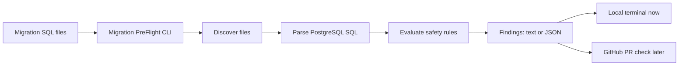

# Migration PreFlight — Project Notes

## Project Overview

### Problem Statement

Database migrations can introduce data loss, deployment failures, application compatibility problems, and database downtime. These risks are often discovered late in review or after deployment.

Migration PreFlight will statically analyze PostgreSQL SQL migration files and identify known risky migration patterns before they are merged or deployed. Each finding will explain the risk and recommend a safer migration approach.

### Intended Users

- Application developers who write PostgreSQL migrations.
- Reviewers who need help identifying migration risks during pull-request review.
- Platform, database, or reliability engineers who want consistent migration-safety checks in CI.

### In Scope for Version 1

- A local command-line tool that analyzes PostgreSQL `.sql` migration files.
- High-confidence checks for:
  - `DROP TABLE` and `DROP COLUMN`
  - Adding `NOT NULL` columns without a safe staged approach
  - Potentially unsafe column type changes
  - `CREATE INDEX` without `CONCURRENTLY`
  - `DELETE` without `WHERE` and `TRUNCATE`
- Findings that include severity, file location, explanation, and a safer alternative.
- Text output for developers and structured JSON output for future automation.
- Automated tests for each rule.

### Out of Scope for Version 1

- GitHub pull-request checks, comments, and authentication.
- Connecting to production databases or running migrations against them.
- Automatically changing or rewriting migrations.
- Guaranteeing that a migration will not cause downtime.
- Proving that application code no longer references a renamed or dropped database object.
- Supporting every migration framework or non-SQL migration format.

## Proposed Architecture

### Components

- **CLI:** Accepts migration paths and output options, then determines the process exit code.
- **Migration discovery:** Finds supported `.sql` migration files.
- **SQL parser:** Converts PostgreSQL SQL into structured statements where possible.
- **Rule engine:** Runs independent migration-safety rules against parsed statements.
- **Reporter:** Formats findings as readable terminal output or JSON.
- **Configuration:** Will define migration paths, enabled rules, and severity overrides.

### Data Flow

1. A developer provides a migration file or directory to the CLI.
2. The CLI discovers relevant `.sql` files.
3. The parser analyzes each SQL statement.
4. The rule engine evaluates supported safety rules.
5. The reporter presents findings.
6. The CLI returns a non-zero exit code when configured findings exist.

### Pull Request to Finding Flow

GitHub integration is intentionally deferred from version 1. Later, a GitHub Action will run the same CLI against migration files changed in a pull request and publish findings as a pull-request check.

## Technology Decision Record
### Typescript and Node.js
 - Typescript -> Implement CLI, parser integration, rule engine, reporting, configuration, GitHub integration
 - Node.js has strong CLI ecosystem and easy integration with GitHub Actions

    Alternatives considered:
     - Go: more parser integration work would be required
     - Python: Lesser type enforcement and no direct path to Node based GitHub Actions

## Milestone Plan

## Design Decision Log

| Date | Decision | Alternatives | Reasoning | Consequences |
| --- | --- | --- | --- | --- |

## Issue and Debugging Log

| Date | Problem / Symptom | Root Cause | Investigation | Fix | What I Learned | Prevention / Follow-up |
| --- | --- | --- | --- | --- | --- | --- |

## Known Limitations and Future Improvements